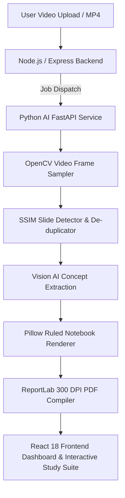

# 📝 NoteForge AI — AI-Powered Lecture to Handwritten Notes Generator

NoteForge AI is an industry-grade full-stack platform that converts educational lecture videos into structured, realistic handwritten study notes and downloadable PDFs using Computer Vision and Vision AI.

---

## 🏛️ System Architecture



---

## 🛠️ Complete Technology Stack

| Layer | Technologies |
|---|---|
| **Frontend** | React 18, Vite, Tailwind CSS, Lucide Icons, React Router v7, Axios |
| **Backend** | Node.js, Express, Mongoose / MongoDB, JWT Auth, Multer, Helmet, CORS |
| **AI Service** | Python 3.12, FastAPI, OpenCV, SSIM (`scikit-image`), Google Gemini Vision, Pillow, ReportLab |
| **Outputs** | 300 DPI Ruled Notebook PNGs, High-Res Compiled PDFs, AI Flashcards, Practice MCQs |

---

## 📁 Repository Structure

```
NoteForgeAI/
├── ai-service/                # Python Computer Vision & AI Microservice
│   ├── generators/
│   │   ├── handwriting.py     # Pillow Ruled Notebook Canvas Renderer
│   │   ├── pdf_generator.py   # ReportLab / Pillow Multi-Page PDF Compiler
│   │   └── test_handwriting_pdf.py
│   ├── processors/
│   │   ├── slide_detector.py  # SSIM Visual Similarity & De-duplication
│   │   └── video_processor.py # OpenCV Adaptive Frame Sampler
│   ├── services/
│   │   ├── vision_service.py  # Gemini Vision & Concept Extractor
│   │   └── notes_service.py   # Structured Notes, Flashcards & Quiz Synthesizer
│   ├── main.py                # FastAPI HTTP Server (:8000)
│   ├── requirements.txt
│   └── test_ai_pipeline.py    # Automated Test Suite for AI Service
│
├── backend/                   # Node.js / Express API Orchestrator
│   ├── src/
│   │   ├── controllers/       # Auth, Lecture, Notes Controllers
│   │   ├── middleware/        # JWT Auth, Multer Video Uploads
│   │   ├── models/            # User, Lecture, Note Mongoose Models
│   │   ├── routes/            # /api/auth, /api/lectures, /api/notes
│   │   ├── services/          # AI Microservice Bridge
│   │   ├── app.js             # Express App Configuration
│   │   └── server.js          # Server Bootstrapper (:5000)
│   ├── package.json
│   └── test_backend.js        # Automated Integration Test Suite
│
├── frontend/                  # React 18 + Tailwind CSS Web Application
│   ├── src/
│   │   ├── components/        # Navbar, Footer
│   │   ├── context/           # AuthContext (JWT session management)
│   │   ├── pages/
│   │   │   ├── LandingPage.jsx     # Modern Hero, Live Note Demo, Pipeline
│   │   │   ├── AuthPage.jsx        # Sign In, Sign Up, 1-Click Demo
│   │   │   ├── Dashboard.jsx       # Lecture Archive & Metrics
│   │   │   ├── CreateNotesPage.jsx # Video Upload Studio & Ink Picker
│   │   │   ├── ProcessingPage.jsx  # Real-time Multi-Stage Progress Tracker
│   │   │   └── NotesViewerPage.jsx # Notebook Flip, Flashcards, Quiz, PDF
│   │   ├── services/          # Axios API Bridge
│   │   ├── App.jsx
│   │   ├── index.css          # Glassmorphism & Notebook CSS tokens
│   │   └── main.jsx
│   ├── index.html
│   ├── tailwind.config.js
│   ├── vite.config.js
│   └── package.json
│
├── uploads/                   # Uploaded lecture video storage
├── generated/                 # Generated slides, note pages, and PDFs
└── README.md
```

---

## 🚀 Getting Started

### 1. Launch Python AI Service
```bash
cd ai-service
pip install -r requirements.txt
python main.py
# Runs on http://127.0.0.1:8000
```

### 2. Launch Backend API
```bash
cd backend
npm install
npm run dev
# Runs on http://127.0.0.1:5000
```

### 3. Launch Frontend Web App
```bash
cd frontend
npm install
npm run dev
# Runs on http://localhost:3000
```

---

## 🧪 Testing

### Test Python AI Service
```bash
python ai-service/test_ai_pipeline.py
```

### Test Node.js Backend
```bash
node backend/test_backend.js
```

### Build Frontend Bundle
```bash
cd frontend
npm run build
```
